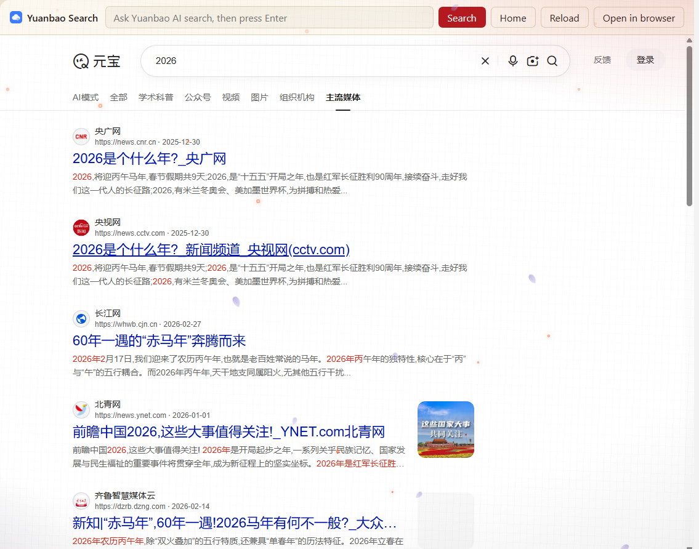

# dsh-yuanbao-search

[中文说明](./README.zh.md) · **English**

Use Tencent **Yuanbao Search** ([so.qq.com](https://so.qq.com/)) as a main panel
inside the [DeepSeek Harness](https://github.com/deepseek-ai) Web UI — sitting next
to panels like *Task board* and *Plugins*. Search results render inside the panel;
nothing is handed off to your system browser.



## Install

The plugin is a Harness bundle: a Host half plus a Web client module.

```bash
# 1. clone next to your Harness workspace
git clone https://github.com/xbbkok/dsh-yuanbao-search.git

# 2. install it into the active profile
#    (Plugin Manager → Add plugin → the cloned directory, or:)
dsh plugin --profile <your-profile> add /absolute/path/to/dsh-yuanbao-search
```

Then enable **Yuanbao Search** in *Plugins* and reload the window once.

> Bundle installation is performed by the plugin manager, which links the
> directory and adds the bundle row. Do not hand-edit the profile's
> `package.json` or `cordis.patch.yml`.

## Use

Click **Yuanbao Search** in the sidebar panel list, between *Context Insights*
and *More*. The main panel switches to Yuanbao Search.

| Control | Behaviour |
|---|---|
| Search box + **Search** | Opens `/iaimode/search?query=<term>` and renders the answer in the panel |
| **Home** | Back to the AI-mode home page |
| **Reload** | Reloads the embedded page |
| **Open in browser** | Opens the current address in your system browser |

Sign-in, history and conversations happen on the Yuanbao site itself. The plugin
never reads, stores or forwards your Yuanbao account information.

## Why the panel opens in AI mode

Yuanbao's plain home search hands the query to `https://www.sogou.com/web?query=…`.
Sogou refuses to be framed, so the Harness shell opens that navigation in the
system browser — the classic "clicking search throws me out of the app" symptom.

The **AI mode** page (`https://so.qq.com/iaimode`) answers entirely on
`so.qq.com`, at a URL shape that can be loaded straight into the panel. The panel
therefore defaults to AI mode, and the toolbar drives the same URL.

## Languages

Panel copy is registered in the Client locale service under the
`yuanbao-search` namespace with `zh` and `en` dictionaries, so labels follow the
Harness interface language. Plugin-card metadata comes from `locale/*.json`.

## Configuration

The Host half is intentionally empty — it registers no service, route or tool, so
the bundle cannot fail activation through a name collision. The panel carries its
own defaults (`https://so.qq.com/iaimode`).

## Known limitations

- **Web (Sogou) search is unavailable inside the panel.** sogou.com forbids
  framing, so that path cannot render in-app; use **Open in browser** when you
  need it.
- If a Yuanbao page interaction calls `window.open`, the shell still resolves it
  in the system browser. AI mode does not trigger this; forcing a sandbox would
  break in-site sign-in, so it is left alone.
- The panel depends on so.qq.com's `/iaimode` route and on the site permitting
  framing. If Tencent changes either, the panel needs a matching update.

## Development

Plain JavaScript, no build step.

```
index.js            Host half: deliberately empty apply()
client.js           Web half: the panel and the sidebar entry
cordis.patch.yml    Bundle patch that inserts the plugin row
locale/{en,zh}.json Plugin-card metadata
icon.svg            Plugin icon
docs/screenshot.png README image
```

Two details matter when hacking on this:

1. A dynamic Client half receives a **restricted** Cordis context — `get`, `on`,
   `provide`, `effect`. There is no `ctx.slots`; use `ctx.get('slots')`.
2. The sidebar entry's `id` must equal the `main` slot key, because the host
   dispatches the panel switch by that id.

## License

[MIT](./LICENSE)
